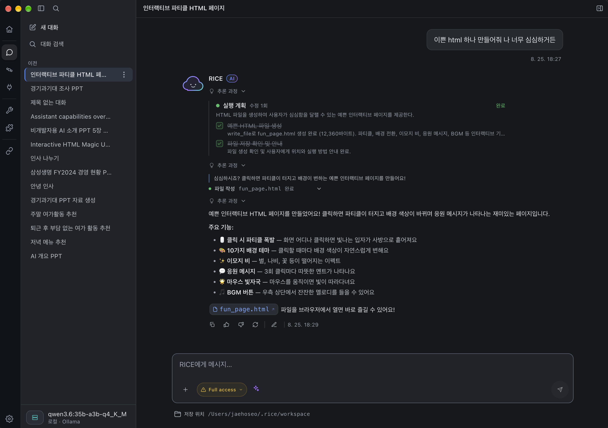

# RICE

RICE는 로컬 런타임을 사용하는 AI 데스크톱 앱입니다. 모델과 대화하고 도구를 실행하며,
반복 작업을 스킬과 메모리로 저장해 다시 사용할 수 있습니다.



## 사전 준비 (Prerequisites)

아래 요구사항은 소스에서 개발 환경을 실행할 때 적용됩니다. 설치 파일을 사용하는
경우 Python과 Node.js를 별도로 설치할 필요가 없습니다.

| 도구 | 요구사항 | 용도 |
|---|---|---|
| Python | 3.13+ | `rice-runtime`, `rice-platform` |
| Node.js | 20+ 및 npm | `rice-app` 개발·빌드 |
| Ollama | 로컬 모델을 사용할 때 필요 | 모델 설치 및 추론 |

저장소 루트에서 다음을 실행합니다.

```bash
python3 -m venv rice-runtime/.venv
rice-runtime/.venv/bin/python -m pip install -e './rice-runtime[claude,connectors,dev]'

python3 -m venv rice-platform/.venv
rice-platform/.venv/bin/python -m pip install -e './rice-platform[test]'

npm --prefix rice-app ci
```

위 가상환경 경로는 macOS/Linux 기준입니다. Windows에서는 각 가상환경의
`Scripts/python.exe`를 사용합니다. 로컬 모델만 사용하면 런타임의 `claude` 추가
의존성은 생략할 수 있습니다.

## 실행

macOS/Linux에서는 저장소 루트의 실행 스크립트를 사용할 수 있습니다.

```bash
./app.sh    # Electron 앱 + 로컬 마켓 서버
./dev.sh    # 브라우저 개발: 런타임 + 마켓 서버 + 프론트엔드
```

Electron 앱은 Python 런타임을 자동으로 시작합니다. 브라우저 개발에서는
`dev.sh`가 런타임 주소를 프론트엔드에 전달합니다.

| 서비스 | 개발 환경 주소 |
|---|---|
| 브라우저 UI | http://localhost:5273 |
| 로컬 런타임 | http://localhost:8080 |
| 로컬 마켓 | http://localhost:7070 |
| Ollama | http://localhost:11434 |

런타임이 연결되지 않으면 앱에 연결 안내가 표시됩니다. 런타임을 시작한 후
**다시 연결**을 누르세요. 연결 전에는 대화·커넥터 동작을 실행하지 않습니다.

### 모델 연결

- **로컬 모델**: `ollama serve`를 실행하고 사용할 모델을 설치합니다.
  앱의 모델 설정에서 Ollama 주소와 설치된 모델을 선택합니다.
- **SaaS 모델**: 앱에서 Anthropic, OpenAI 또는 OpenAI 호환 제공자를 선택하고
  모델명과 API 키를 등록합니다. 커스텀 제공자는 API 주소도 입력합니다.

모델의 온도·Ollama 주소·추론 표시 설정은 채팅 화면의 모델 설정에서 관리합니다.

### 마켓 소스

마켓 서버는 기본적으로 `rice-platform/artifacts/`의 패키지를 읽습니다.
별도 `rice-marketplace` 저장소는 선택 사항입니다. 저장소 옆에 해당 디렉토리가
있으면 실행 스크립트가 자동으로 사용하며, 다른 위치는
`RICE_MARKETPLACE_DIR` 환경변수로 지정할 수 있습니다.

### 구성 요소를 따로 실행하기

각 명령은 별도 터미널에서 저장소 루트를 기준으로 실행합니다.

```bash
rice-runtime/.venv/bin/rice-runtime --host 127.0.0.1 --port 8080 --token ''
rice-platform/.venv/bin/rice-platform --host 127.0.0.1 --port 7070
cd rice-app && npx vite --config vite.renderer.config.ts
```

브라우저 UI는 기본적으로 `http://localhost:8080`의 런타임에 연결합니다.
주소와 인증 토큰을 바꾸려면 Vite 실행 전에 `VITE_RICE_RUNTIME_URL`과
`VITE_RICE_RUNTIME_TOKEN`을 지정합니다. Electron에서도 API와 스트리밍은
localhost HTTP/SSE를 사용하며, IPC는 런타임 관리와 OS 기능에 사용합니다.

## 현재 기능과 제약

- 대화 스트리밍, 대화 이력, 중지·재생성, 생성 파일 열기
- 실행 계획, 로컬 도구와 MCP 호출, 도구 실행 승인
- 스킬·메모리 저장, 학습 제안 검토, 스킬 편집·복원
- 마켓 패키지 설치·게시와 로컬 MCP 등록

일부 기능에는 추가 설정이나 별도 서버가 필요합니다. Google 커넥터는 OAuth
설정과 해당 서비스 권한이 필요하며, 커넥터 디렉토리의 준비 중 항목은 아직
기본 연결을 지원하지 않습니다. 마켓 사용에는 `rice-platform`이 필요합니다.

SaaS 모델 등록 키는 로컬 `state.db`에 저장되고 선택한 모델 제공자에 요청할 때
인증에 사용됩니다. API 응답에는 마스킹된 키만 반환합니다. Google 커넥터의
OAuth 자격증명은 OS 키체인을 사용합니다. 데이터 보관과 외부 모델 호출은
서로 다른 동작이며, SaaS 모델에는 요청에 포함된 대화·도구 결과가 전달됩니다.

일반 설정 화면의 테마·글꼴·언어는 적용됩니다. 같은 화면의 별도 Ollama 주소,
자동 시작·사용자 모델링·로컬 저장·텔레메트리 옵션은 현재 저장만 되며 실행
제어에 연결되지 않았습니다. 실제 모델 연결은 채팅의 모델 설정을 사용합니다.

포인트·후원과 기본 학습 효과 데이터에는 발표용 구현이 남아 있습니다.
다운로드 수·평가 결과를 실제 서비스 통계나 모델 성능 검증으로 해석하지 마세요.

## 확인과 배포

```bash
npm --prefix rice-app run type-check
npm --prefix rice-app run lint
npm --prefix rice-app run build:react

cd rice-runtime && .venv/bin/python -m pytest
```

설치 파일은 `rice-app`에서 `npm run package:mac`, `package:win`,
`package:linux`로 생성합니다. 각 대상 OS에서 빌드해야 하며, 런타임 준비와
앱 빌드를 함께 수행합니다. 자세한 내용은
[데스크톱 배포 문서](rice-app/docs/distribution.md)를 참고하세요.

## 개발 문서

| 문서 | 내용 |
|---|---|
| [앱 README](rice-app/README.md) | UI 개발·빌드와 설정 저장 경로 |
| [런타임 README](rice-runtime/README.md) | 모델·도구·학습·로컬 API |
| [마켓 README](rice-platform/README.md) | artifact 레지스트리와 마켓 API |
| [디자인 시스템](rice-app/docs/DESIGN_SYSTEM.md) | UI 토큰·접근성·레이아웃 |
| [다국어 문서](rice-app/docs/i18n.md) | 번역 카탈로그와 키 관리 |
| [제품 설계](RICE_PRODUCT_IDEA.md) | 제품 방향과 설계 배경 |
| [저장소 구성](RICE_REPO_STRATEGY.md) | 구성 요소와 책임 |
| [런타임 구성](RICE_RUNTIME_DIRECTORY.md) | 모듈 구조와 위치 |
| [런타임 설계](RICE_RUNTIME_DESIGN.md) | 설계 의도와 알려진 구현 격차 |
| [실행 모델](RICE_AGENT_EXECUTION.md) | 계획·도구 실행·컨텍스트 |
| [학습 루프](RICE_LEARNING_LOOP_DESIGN.md) | 스킬·메모리·제안 |
| [학습 평가](RICE_LEARNING_EVAL.md) | 평가 방법과 데이터 계약 |
| [API 계약](RICE_CONTRACTS.md) | 런타임·마켓 API와 artifact 형식 |
| [마켓 설계](RICE_PLATFORM_DESIGN.md) | 카탈로그·게시·레지스트리 |

설계 문서는 배경과 계약을 설명합니다. 현재 동작과 실행법은 위 README 및
각 구성 요소의 코드·패키지 설정을 기준으로 확인합니다. 참조 분석은
[Hermes 학습 루프](HERMES_LEARNING_LOOP_REFERENCE.md)와
[Hermes 도구 시스템](HERMES_TOOL_SYSTEM_REFERENCE.md)에 있습니다.
