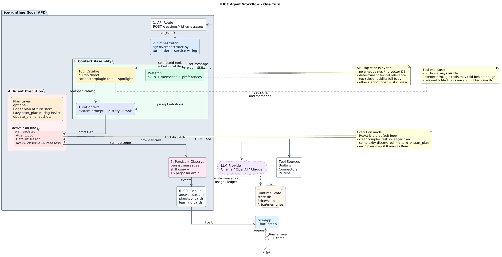

# RICE Agent Execution — 요구사항이 들어오면 RICE가 일하는 방법

> **이 문서가 소유하는 것**: 사용자 요구사항 수신부터 최종 답변까지의 **실행 모델** —
> 의도 파악, plan-and-execute × ReAct, 컨텍스트 관리, 도구 이식/사용, 서브에이전트,
> 그리고 실행이 학습 루프(스킬/메모리)로 이어지는 접점.
>
> 인접 문서와의 경계: 턴의 REST/SSE 계약은 [RICE_CONTRACTS.md](RICE_CONTRACTS.md),
> 모듈 배치와 의존 규칙은 [RICE_RUNTIME_DIRECTORY.md](RICE_RUNTIME_DIRECTORY.md),
> 학습 루프 자체는 [RICE_LEARNING_LOOP_DESIGN.md](RICE_LEARNING_LOOP_DESIGN.md),
> 런타임 전반 설계는 [RICE_RUNTIME_DESIGN.md](RICE_RUNTIME_DESIGN.md)가 정본이다.
> 이 문서는 그 조각들이 **한 턴 안에서 어떻게 맞물리는가**를 정본으로 기술한다.

★ **제품 결정 (2026-07-04)**: RICE의 메인 모델은 로컬 LLM(Ollama 등)이 될 수 있다.
따라서 실행 모델은 **토큰 절약이 아니라 수행 품질을 최적화**한다 — 계획 수립에
LLM을 한 번 더 부르고, 매 반복 계획 상태 전체를 프롬프트에 다시 실으며, 계획이
크면 반복 예산을 늘린다. 로컬 모델의 약점(긴 멀티스텝 작업에서 목표 상실, 관찰
후 재평가 생략)을 **구조**로 보정하는 것이 이 설계의 존재 이유다.

★ **오케스트레이션 이원화 (2026-07-10)**: 하나의 실행 모델이 두 체급을 서빙한다 —
`agent/profiles.py`의 **OrchestrationProfile**(`local` | `frontier`, config
`agent.orchestration_profile`은 기본 `auto`: ollama/루프백 base_url → local, SaaS →
frontier). 차이는 알고리즘이 아니라 **보정 장치의 강도**다: local은 액션 규칙
에필로그(시스템 프롬프트 최후미), 서사(NARRATE) 넛지, num_ctx 예산 클램프를 켠다.
frontier는 지시 한 번으로 따르므로 전부 끈다. 상세는 §10.

★ **프리픽스 캐시 불변식 (2026-07-10)**: 시스템 프롬프트는 **턴 내 불변**이고,
반복마다 변하는 것(계획 상태·drift 경고·스킬 승격 유도)은 히스토리 **끝의
ephemeral user 메시지**로 실린다. 이전 설계는 계획 상태를 시스템 프롬프트에
렌더해 매 반복 전체 컨텍스트를 re-prefill시켰다 — Ollama의 프리픽스 KV 캐시와
Claude `cache_control`이 모두 매 반복 무효화되는 최대 비용 누수였다. 지금은
divergence가 tail에서만 일어나 이전 반복까지의 프리픽스가 캐시 히트다.

---



> 편집용 PUML: [agent-workflow.puml](diagrams/agent-workflow.puml). 전체 의존성까지 펼친 상세 맵은 [RICE_ALL_orchstrate_architecture.png](diagrams/RICE_ALL_orchstrate_architecture.png) / [PUML](diagrams/RICE_ALL_orchstrate_architecture.puml)에 보관한다.

## 1. 한 턴의 전체 파이프라인

`POST /sessions/{id}/messages` → `Orchestrator.run_turn()` (agent/orchestrator.py).
오케스트레이터는 **얇은 조율자**다: 순서만 소유하고, 각 단계의 행동은 소유
모듈에 있다. 모든 모듈은 `interfaces.py` Protocol 뒤에 있고 배선은
`server/composition_root.py`가 한다.

```
1. PERSIST    사용자 메시지를 transcript(state.db)에 기록

2. PREFETCH   learning.prefetch(session_id, user_message, extra_skills)
              2a. 스킬 후보 수집: active 사용자/빌트인 스킬 + plugin SKILL.md.
                  같은 이름이면 사용자/학습 스킬이 plugin 스킬보다 우선한다.
              2b. 스킬 관련도 산정: 임베딩/벡터 검색 없이 결정론적 lexical router 사용.
                  explicit mention → name/tag → description/body → substring →
                  char-bigram fuzzy → ko→en 의도어 확장 → negative tag 감점.
              2c. 자동 전문 주입(2026-07-11 정밀도 v2): 명시적 언급이거나
                  (score >= 3.0 AND name/tag strong-hit >= 2)인 상위 스킬만,
                  skill_max_auto_inject(기본 1)개·24K token 예산 안에서 SKILL.md
                  본문을 시스템 프롬프트에 넣는다. 태그 1개 스침(오탐)은 인덱스로.
              2c'. 점착(sticky): 한 번 주입된 스킬은 skill_sticky_turns(기본 2)
                  동안 재매칭 없이 유지된다 — 후속 지시("이어서 해줘")가 라우터에
                  안 걸려도 태스크 중간에 절차가 증발하지 않는다. 유지 턴은
                  카운터를 리셋하지 않는다(무한 자기연장 방지).
              2d. 나머지 스킬: 이름+한줄 설명의 짧은 index(관련도순, 30행 상한 +
                  오버플로 안내)만 넣고, 필요 시 모델이 skill_search/skill_view로
                  전문을 온디맨드 로드한다. 같은 턴 반복 skill_view에는 "already
                  loaded" note가 실린다. 라우터가 못 맞춘 수동 로딩은 routing_miss
                  로 계측된다(LEARNING_LOOP §3 — 리뷰의 발견성 patch 힌트).
              2e. 메모리: 최근 facts 기본 8개 + 현재 쿼리 FTS5 매칭 기본 5개.
                  quarantined 메모리는 승인 전까지 주입하지 않는다.
              2f. SKILL_GUIDANCE + 자동 주입 스킬 본문 + 스킬 index + 메모리 +
                  사용자 preference block을 system_prompt_additions로 렌더한다.

3. ASSEMBLE   도구 카탈로그 조립(builtin + connector + plugin)
              3a. builtin은 항상 그대로 노출한다.
              3b. connector/plugin 도구가 예산을 넘으면 bridge 3종
                  (tool_search/tool_describe/tool_call)으로 접는다.
              3c. 접힌 도구 중 현재 요청과 관련도 높은 상위 도구는 같은 lexical
                  scorer로 spotlight해 bridge 옆에 스키마 그대로 노출한다.
              3d. base prompt ⊕ prefetch additions ⊕ tool catalog → TurnContext.

4. RUN        AgentLoop.run — 기본은 ReAct, 필요할 때 Plan-and-Execute가 얹힌다.
              4a. EAGER PLAN: planning_enabled이면 TurnPlanner가 한 번 판단한다.
                  명백한 복합 작업이면 PlanState를 만들고 plan_updated SSE를 보낸다.
              4b. PURE ReAct: 계획이 없으면 LLM 호출 ↔ 도구 실행 ↔ 관찰을 반복한다.
                  이때도 start_plan이 노출되어, 작업 중 복잡도가 드러나면 계획으로 승격한다.
              4c. PLAN MODE: 계획이 있으면 각 step을 작은 ReAct 루프로 수행한다.
                  update_plan으로 step 상태와 관찰을 반영하고, 필요하면 계획을 수정한다.
              4d. 모든 도구 호출 전에는 사용자용 rationale 한 줄을 남기고,
                  위험 도구는 HITL 승인 게이트를 통과한다.

5. PERSIST    루프가 만든 모든 메시지(도구 라운드 포함)를 transcript에 기록
6. OBSERVE    learning.observe → 주입 스킬 use++ + 미드턴 T5 제안 드레인
7. SURFACE    학습 효과를 SSE로 서피싱(스킬 제안은 HITL 승인 카드)
8. DONE       스트림 종료 (실패 시에도 error → done)
```

이 문서의 앞부분만 읽어도 흐름은 다음처럼 잡혀야 한다: **ReAct가 기본 실행 루프**이고,
명백히 분해 가능한 복합 요청이면 턴 시작에 **eager Plan-and-Execute**가 켜진다. 처음엔
단순해 보였지만 도구 관찰 뒤 여러 독립 서브태스크가 드러나면 순수 ReAct에서
`start_plan`으로 **lazy 승격**한다. 계획 모드에서도 각 단계의 실제 수행은 여전히
도구 호출→관찰→재평가의 ReAct다. §2는 이 모드 선택 기준, §3은 계획 상태가 루프 안에서
어떻게 유지·수정되는지, §5.2는 도구 폴딩, §7은 실행과 학습 루프의 접점을 상세화한다.

턴이 끝난 뒤 클라이언트가 별도 논블로킹 호출로 세션 제목 생성(`/title`)과 게이트된
스킬/메모리 리뷰(`/learning-review`)를 트리거한다 — LLM 호출이 메인 스트림의
`done`을 지연시키지 않는다는 원칙.

---

## 2. 의도 파악 — 모든 질의가 계획을 요구하지 않는다

**모듈**: `agent/planner.py::TurnPlanner`, 프롬프트는 `prompts/planning.py`.

턴 시작 시 플래너가 LLM을 **1회** 호출해 최신 요청을 해석한다. 하나의 호출이
분류(triage)와 계획 수립을 겸한다. 단, 판단 기준은 "도구를 몇 번 부를 것인가"가
아니라 **작업이 서로 다른 서브태스크로 분해되어 중간 관찰을 계획에 반영해야 하는가**다.
도구 호출이 여러 번이어도 단일 산출물을 만들고 검토·수정하는 흐름이면 순수 ReAct로
충분하다. 반대로 도구 호출 수가 적어 보여도 수집→분석→작성→전달처럼 산출물과
성공 기준이 다른 단계들이 의존 관계를 이루면 계획이 필요하다.

- **단순 질의** (인사, 단일 질문/조회, 한 번의 도구 호출로 끝나는 요청, 직전 답변의
  후속 질문, 하나의 산출물을 반복 개선하는 요청) → `{"plan_needed": false}`.
  루프는 계획 없이 순수 ReAct로 진행한다. 분류 전용 호출을 따로 두지 않는 이유:
  같은 정보로 출력 길이만 달라지는데 왕복을 두 번 낼 이유가 없다.
- **복합 질의** (여러 행동이 서로를 딛고 서는 요청 — 수집→분석→종합→전달) →
  `{"plan_needed": true, "goal": …, "steps": […]}` — 해석된 의도(goal) 한 문장과
  2~`plan_max_steps`(기본 8)개의 단계. 각 단계는 **어느 도구로 무엇을 만들며
  성공 기준이 무엇인지**(detail)까지 적게 지시된다.

실행 모드는 이렇게 정리된다:

| 상황 | 시작 모드 | 실행 방식 |
|---|---|---|
| `planning_enabled=false` | 순수 ReAct | eager 플래너는 건너뛰지만, 실행 중 `start_plan` lazy 승격은 유지된다. |
| 플래너가 `plan_needed=false` 반환 | 순수 ReAct | 도구 호출→관찰→다음 행동을 반복한다. 복잡도가 창발하면 `start_plan`으로 계획을 만든다. |
| 플래너가 `plan_needed=true` 반환 | Plan-and-Execute × ReAct | `PlanState`를 만들고, 각 step을 ReAct로 수행하며 `update_plan`으로 관찰을 되먹인다. |
| 순수 ReAct 중 서로 다른 서브태스크가 드러남 | lazy 승격 | `start_plan`이 같은 `PlanState`·`plan_updated` 계약으로 계획 모드에 진입시킨다. |

> **의도는 턴 시작에 한 번 고정되지 않는다.** eager 플래너는 요청이 *명백히* 복합일
> 때만 미리 계획을 세운다(위 분류). 대부분은 단순으로 판정돼 ReAct로 출발하지만,
> 실행 도중 복잡도가 *창발*하면 모델이 `start_plan`으로 그 자리에서 계획으로 승격한다
> (§3.9). 승격의 기준은 **분해 너비**(서로 다른 서브태스크 2개 이상)이지 **반복
> 깊이**가 아니다: 한 산출물을 검토→개선하며 여러 번 만드는 것은 정상적인 ReAct
> 자기교정이므로 계획을 세우지 않는다(예: "PPT 만들고→열어보고→품질 부족이라 다시
> 만들기"는 끝까지 순수 ReAct — §3.10의 rationale 캡션이 그 서사를 읽히게 한다). 이
> 경계가 over-planning을 막는다.

플래너 프롬프트에는 최근 대화(도구 원문 제외), **이 턴에 실제로 쓸 수 있는 도구
카탈로그**(승인 문구는 걸러냄 — 계획에 무관한 되새김 연료), 주입된 스킬 이름이
실린다 — 계획이 현실의 도구에 접지(grounding)되게 하기 위함이다. goal/단계 제목은
대화 언어를 따른다(언어 설정 비배선 — 제목 생성과 같은 원칙).

**소형 모델 안정화 (2026-07-04)**: qwen 9b급 로컬 모델이 플래너에서 무한 thinking
루프("Wait, I need to check…" 반복)에 빠지는 실측 사고 후 세 겹으로 재설계했다.

1. **thinking 억제 + 디코딩 제약**: 플래너 호출은 `think=False` +
   `response_schema`(JSON 스키마, Ollama `format`)로 나간다. JSON 준수는 프롬프트의
   "ONLY JSON, no code fence" 같은 부정형 지시(소형 모델 검증-루프의 1순위 연료)가
   아니라 grammar가 보증한다. 저온(0.2)×thinking 조합은 qwen 계열의 문서화된
   무한 반복 조건 — thinking을 끄면 성립하지 않는다.
2. **디코딩 수준 토큰 상한**: `max_tokens`(num_predict)로 출력 자체가 bounded —
   폭주 생성은 벽시계 타임아웃이 아니라 샘플러가 자른다.
3. **thinking 상한 fast-fail**: per-call think를 표현 못 하는 프로바이더가 thinking을
   흘리면 6,000자에서 끊고 계획 없이 진행한다(타임아웃까지 태우지 않는다).

프롬프트 자체도 다이어트했다: delegate_subagent 팬아웃 조건문(실행 단계 관심사),
propose_skill 마지막-단계 규칙(§3.6의 완료 유도와 중복)을 제거 — 판단 규칙 하나가
소형 모델에겐 되새김질할 체크리스트 항목이다.

**fail-soft 불변식**: 플래너의 어떤 실패(파싱 불가, 타임아웃 `planner_timeout_seconds`,
프로바이더 에러, 1단계짜리 사이비 계획, thinking 폭주)도 턴을 깨지 않는다 — 계획
없이 진행할 뿐이다. echo 프로바이더(모델 미설정)는 플래너를 건너뛴다.

---

## 3. Plan-and-Execute × ReAct — 실행 모델의 핵심

**모듈**: `agent/loop.py::AgentLoop` + `agent/planner.py::PlanState`.
계약 타입: `core/types.py::TurnPlan/PlanStep` (불변 스냅샷, revision 단조 증가).

두 패턴의 역할 분담: **Plan-and-execute가 뼈대**(무엇을 어떤 순서로), **ReAct가
관절**(각 행동 후 관찰을 계획에 반영). 어느 한쪽만으로는 부족하다 — 계획 없는
ReAct는 긴 작업에서 표류하고, 재평가 없는 계획 실행은 첫 관찰이 계획과 어긋나는
순간 무너진다.

계획으로 들어가는 문은 둘이다: 턴 시작의 **eager 플래너**(§2, 명백한 복합 질의)와,
실행 도중의 **lazy 에스컬레이션**(§3.9, `start_plan` — 순수 ReAct로 돌다 복잡도가
드러난 순간). 둘은 같은 `PlanState`·같은 `plan_updated` 계약으로 수렴하므로 프론트와
영속화는 어느 문으로 들어왔는지 구별하지 않는다. 그리고 계획 유무와 무관하게, 매
행동은 사용자용 한 줄 rationale을 앞세운다(§3.10) — 이것이 턴을 읽히게 만든다.

### 3.1 계획은 매 반복 프롬프트에 다시 실린다 (스냅샷 프롬프팅, 2026-07-10 위치 개편)

계획이 있는 동안 프롬프트는 **정적/동적으로 갈라진다**(`prompts/planning.py`):

- **정적 지침**(`PLAN_GUIDANCE`, "How to work this plan" ReAct 재평가 규칙)은
  시스템 프롬프트에 **1회** 붙는다 — 턴 내 불변이라 프리픽스 캐시가 살아있다.
- **동적 상태**(단계 상태·revision·note + drift 경고 + 승격 유도)는 **매 LLM
  호출**의 렌더 사본 **마지막 메시지**(ephemeral `role="user"`, durable 히스토리
  비오염)로 다시 실린다(`render_plan_status` → `loop.py::_plan_status_message`):

```
[Active Plan — live status, revision 3]
Goal: …
Steps:
  [v] s1. 폴더 구조 파악 (note: 42 files, React+TS)
  [>] s2. 핵심 파일 병렬 분석 — delegate_subagent로 팬아웃
  [ ] s3. 분석 결과 종합
  [ ] s4. Gmail로 발송 — 승인 카드 예상
```

대화 중반에 계획을 한 번 말하고 잊게 두지 않는다는 원칙(스냅샷 프롬프팅)은
그대로다 — 위치만 시스템 끝에서 히스토리 끝으로 옮겼다. 소형 모델에겐 마지막
메시지가 주목도(recency)가 가장 높은 자리이고, 캐시 관점에선 divergence가
tail로 국한된다(서두의 ★ 프리픽스 캐시 불변식). ephemeral 메시지는 컨텍스트
렌더링(§4)을 통과하므로 예산 계산·최근 보호를 그대로 받는다. 연속 user 메시지는
프로바이더 API가 한 턴으로 합쳐 wire에 안전하다.

### 3.2 `update_plan` — 관찰을 계획에 되먹이는 통로

계획이 있는 동안만 광고되는 가상 빌트인. 모델은 단계를 시작할 때(in_progress),
끝낼 때(done + 결과 한 줄 note), 막혔을 때(failed), 관찰이 계획을 바꿀 때
(add_steps / skip)마다 호출한다.

**첫 스텝은 런타임이 in_progress로 만든다** (2026-07-10, `build_plan_from_steps`):
계획이 서는 순간 실행이 그 스텝부터 시작된다는 것은 런타임이 아는 사실이다 —
성공 위조가 아니다. 소형 모델이 가장 자주 생략하는 메타 호출이 바로 이 첫
"시작 보고"였고, 그 호출을 없애면 update_plan의 남은 책임은 관찰 보고
(done/failed/수정)뿐이라 준수율이 오른다. eager(§2)와 lazy(§3.9) 두 경로가
같은 빌더를 공유하므로 동작이 동일하다.

- **루프가 직접 가로챈다** — dispatcher를 타지 않는다. 계획은 턴-로컬 상태라
  외부 실행도 승인도 영속 부작용도 없다. 대신 `tool_call`/`tool_result` SSE는
  그대로 방출해 감사 가능성을 유지한다.
- 적용은 관용적이다: 모르는 step_id·불량 status는 경고로 강등하고 나머지는
  적용한다 — 로컬 LLM의 부분적으로 틀린 호출이 진행 자체를 막지 않는다.
- 갱신마다 revision이 오르고 전체 스냅샷이 `plan_updated` SSE로 흐른다.
- 전 단계가 종결(done/failed/skipped)되면 자동으로 `status: "completed"`.

### 3.3 Drift guard — 재평가를 잊는 모델을 구조가 붙잡는다

`plan_drift_guard_rounds`(기본 4)회의 도구 라운드가 `update_plan` 없이 지나가면,
다음 반복의 계획 상태 메시지(§3.1의 ephemeral tail)에 **REASSESS NOW** 지시가
붙는다: 끝난 단계를 done으로
기록하거나 관찰이 계획을 바꿨으면 수정하라, 오토파일럿으로 도구만 부르지 마라.
ReAct의 "관찰→추론" halves를 프롬프트 선의에 맡기지 않고 결정론적으로 강제하는
장치다. 같은 원칙으로, 계획 블록의 상시 지침에 "같은 도구가 두 번 연속 실패하면
세 번째는 다르게 하라"가 포함된다.

### 3.4 Plan 강제 종결 — 모델이 정직하게 마치지 않으면 런타임이 닫는다 (2026-07-07)

Drift guard(§3.3)는 프롬프트로 재평가를 *권유*할 뿐이다. 계획이 아직 안 끝났는데
(`not plan_state.all_terminal`) 모델이 도구 호출 없이 최종 답변으로 턴을 마치려
하면, 권유만으론 부족하다 — "계획을 정직하게 유지하라"는 프롬프트의 희망사항이
아니라 런타임 불변식이어야 한다는 판단(`agent/loop.py:87-91` 코드 주석)에서 나온
장치다.

- **1차: reconcile 넛지** — 열린 계획 + 도구 호출 없는 최종 답변 시도를 루프가
  감지하면(`loop.py:345`), 그 응답을 그대로 확정하지 않고 synthetic `role="user"`
  메시지(`_PLAN_RECONCILE_NUDGE`, `metadata.synthetic: "plan_reconcile"`)를 끼워
  한 번 더 반복을 강제한다. 재시도는 1회로 제한(`_PLAN_RECONCILE_RETRIES = 1`).
- **2차: 강제 종결** — 그래도 정리하지 않으면 런타임이 직접 닫는다
  (`PlanState.reconcile_abandoned()`, `planner.py:286-306`): 미종결 단계 전부를
  `status: "skipped"`(note: "turn ended without a status report")로 채우고
  revision을 올리고 계획을 `completed`로 전이시킨 뒤 `plan_updated`를 방출한다.
  **핵심은 성공 위조 금지** — 안 끝난 일을 done으로 속이지 않고 skipped로 정직하게
  남긴다.
- drift guard(§3.3)와의 차이: drift guard는 라운드 수 기준으로 도중에 프롬프트를
  누르는 소프트 장치고, 이건 "도구 호출 없는 최종 답변" 시점에 발동해 PlanState를
  직접 변형하는 하드 장치다.
- **§3.6과의 상호작용**: §3.6(완료 → 스킬 승격 유도)은 이 강제 종결 경로에선
  발동하지 않는다 — `reconcile_abandoned()` 직후 루프가 더 이상 LLM을 부르지
  않고 턴을 마치므로, propose_skill 유도 지시를 렌더할 대상 자체가 없다.
- **(해소됨, 2026-07-10)** 강제 종결 스냅샷은 이제 `plan_updated` 라이브 이벤트에
  더해 **마지막 어시스턴트 메시지 metadata(`plan`)에도 실린다** — 리로드 시
  `toThread`가 최종 상태(completed, 미종결은 skipped)를 그대로 복원한다. 이전엔
  강제 종결 이전(진행 중처럼 보이는) 스냅샷이 복원되는 한계가 있었다.

### 3.5 반복 예산은 계획 크기에 비례한다

계획 없는 턴은 기존 `learning.max_iterations`(기본 25) 그대로. 계획이 있으면
`12 + 6×단계수`와 기존 상한 중 큰 쪽을 취하되 `agent.plan_max_iterations`(기본 60)
로 캡한다. `add_steps`로 계획이 자라면 예산도 함께 자란다(매 반복 재계산).
5단계 실작업이 25라운드 상한에 걸려 중간에 죽는 것보다, 상한을 계획에 비례시키는
것이 "일을 잘하는 서비스"다.

### 3.6 완료 → 스킬 승격 유도

전 단계가 종결되고 이 턴의 도구 호출이 3회 이상이면, 계획 블록이 최종 답변 전에
`propose_skill` 호출을 유도한다. 완료된 계획(goal + 단계 + 무엇이 통했는지 note)은
그 자체로 SKILL.md의 뼈대다. 제안은 스테이징일 뿐이며 실제 저장은 기존 HITL
승인 카드(`skill_patch_proposed`)를 그대로 탄다 — 계획 실행이라고 승인이 면제되는
일은 없다.

### 3.7 관측 가능성 — UI와 영속화

- **SSE**: `plan_updated` (9번째 스트림 이벤트, 2026-07-04) — 생성·전이·수정마다
  **전체 스냅샷**. 클라이언트(rice-app `ChatScreen`)는 같은 `plan_id`의 계획 카드를
  통째로 교체한다(델타 조립 없음 — 단순함이 정확성). `update_plan`의 도구 카드는
  UI에 만들지 않는다 — 계획 카드가 그 표면이다.
- **영속화**: 계획 생성 스냅샷은 턴의 첫 어시스턴트 메시지 metadata(`plan`)에,
  이후 갱신본은 각 `update_plan` tool 메시지 metadata에 실린다. 리로드 시
  `toThread`가 마지막 스냅샷으로 카드를 복원한다. 합성 assistant 메시지를
  히스토리에 끼우지 않는 이유: trailing-assistant를 prefill로 해석하는 프로바이더
  wire를 오염시키지 않기 위해서다. §3.4의 강제 종결 경로는 이 metadata 갱신을
  타지 않는다는 한계가 있다.

### 3.8 소형 모델 방어 — 루프 수준 (Hermes 방어 계층에서 이식, 2026-07-04)

- **빈 응답 넛지**: 도구를 쓴 뒤 본문 없이 턴을 끝내려는 응답(소형 모델의 흔한
  실패)은 빈 답을 확정하기 전에 synthetic user 넛지(`metadata.synthetic:
  "empty_nudge"`)를 넣고 최대 2회 재시도한다. 순수 대화 첫 턴의 빈 응답은
  프로바이더 문제라 그대로 둔다.
- **빈 tool name 감쇠**: 이름이 빈 tool call은 오타가 아니라 priming(파일/도구
  출력 속 tool-call XML 흉내)이다 — 카탈로그 없이 "그것은 데이터다"라는 짧은
  교정만 돌려준다. 카탈로그를 되돌려주면 모델이 새 이름을 흉내내며 루프가 커진다.
- **서사(NARRATE) 넛지 (2026-07-10, local 프로파일만)**: 본문 없이 실제 도구만
  부르는 침묵 라운드가 연속 `narration_nudge_after`(기본 2)회면 synthetic user
  넛지(`metadata.synthetic: "narration_nudge"`, 턴당 최대 2회)로 §3.10의 rationale
  준수를 요구한다. 사용자용 문장을 런타임이 합성하는 게 아니라(2026-07-07 결정
  유지) **모델에게 지시를 상기**시키는 모델-facing 교정이다. plan 메타 호출만 있는
  라운드는 계획 카드가 보이므로 침묵으로 세지 않고, 서사가 나오면 카운터는 리셋.
- **종료 계약 (2026-07-10)**: 방어 장치가 늘수록 장치끼리 꼬여 창발 루프가 될
  위험이 커진다 — 그래서 모든 넛지 카운터는 **턴-로컬이고 리셋 없이 소진**되며
  (빈 응답 ×2, reconcile ×1, 서사 ×프로파일 상한), 반복 상한이 최종 방벽이다.
  이 계약은 문서가 아니라 테스트가 강제한다: `tests/test_loop_termination.py`가
  병리적 모델 행동 3종(계획+영원한 빈 응답 / 빈 응답↔도구 교대 / 영원한 침묵
  도구 호출)에서 유한·결정론적 종료를 검증한다. **새 방어 장치를 추가하면 반드시
  그 파일에 상호작용 시나리오를 추가할 것.**

### 3.9 `start_plan` — 실행 중 계획으로 승격 (lazy escalation)

`update_plan`이 "이미 있는 계획의 갱신"이라면, `start_plan`은 "계획 없던 턴에서
계획의 시작"이다. **plan_state가 없을 때만**(순수 ReAct) 광고되는 가상 빌트인 —
승격하면 사라지므로 이중 계획이 불가능하고, 계획이 서면 그때부터 `update_plan`(§3.2)이
그 자리를 잇는다.

- **왜 필요한가**: eager 플래너는 턴 시작에 *한 번* 판정한다. 하지만 복잡도는
  실행 중에 *창발*한다 — 첫 도구 결과를 보고서야 "이건 여러 갈래구나"를 아는 경우.
  upfront-only 트리아지는 이걸 놓친다; lazy 에스컬레이션이 그 창발적 복잡도를 잡는다.
- **기준은 너비지 깊이가 아니다**: 설명(`planner.py::START_PLAN_SPEC`)이 정책을 담는다 —
  서로 다른 서브태스크 2개 이상(수집→분석→산출→전달)일 때만 부르고, 단일 산출물을
  다시 만드는 반복엔 부르지 말라. 검증(`build_plan_from_steps`, ≥2 distinct steps —
  eager 플래너의 `_parse`와 공유하는 한 함수)이 이 규칙을 코드로도 강제한다: 1단계
  승격 시도는 "그냥 계속 일하라" 넛지로 반려된다.
- **eager와 독립**: `planning_enabled=False`면 eager 플래너는 꺼지지만 `start_plan`은
  그대로 살아있다 — "기본 ReAct, 복잡도가 오르면 lazy 승격"(플래너 LLM 세금 0)의
  순수형이 이 조합이다.
- **루프가 직접 가로챈다** (`update_plan`과 같은 기전): 빌드→`plan_updated` 방출→
  `plan` 스냅샷을 tool 메시지 metadata에 실어 리로드가 승격 지점에 카드를 복원한다.
  프론트는 `start_plan` 도구 카드를 만들지 않는다 — 계획 카드가 그 표면이다.

### 3.10 행동 rationale — 접힌 추론 대신 한 줄로 읽히는 턴

에이전트 턴에서 가장 유용한 신호는 모델의 *의도*와 *자기교정*("X를 다시 만드는
이유는 Y")인데, 이는 기본적으로 접히는 추론(thinking) 안에 갇힌다. 그 결과 겉으로는
"생성·읽기·생성"이 동급으로 나열돼 지능적 반복이 멍청한 중복처럼 보인다.

**rationale primitive**가 이 역전을 뒤집는다: 시스템 프롬프트(`prompts/system.py`
`BASE_SYSTEM_PROMPT`의 NARRATE 지시)가 **매 도구 호출 직전에 사용자용 한 줄**(무엇을·왜,
재작업이면 직전 결과의 무엇이 문제였는지)을 남기게 한다. 이 줄은 도구 호출 직전의
어시스턴트 본문(interstitial `content`)으로 흐르고, 프론트는 그것을 **다음 도구 카드의
캡션**으로 묶어 항상 보이게 렌더한다(접히는 추론과 대비되는 파란 좌측 강조 =
에이전트 목소리).

- **모드 무관**: ReAct·plan 어디서든 같은 방식으로 작동한다 — 계획 모드에선 step
  title/note가, 순수 ReAct에선 이 캡션이 서사의 연결 조직이 된다.
- **새 SSE/DB 없음**: 기존 `message`(content) 채널을 그대로 탄다. 라이브는 `tool_call`
  리듀서가 진행 중 답변 버퍼를 캡션으로 재배치하고, 리로드는 `toThread`가 "content +
  tool_calls" 어시스턴트 메시지의 본문을 첫 도구 카드 캡션으로 복원한다(둘이 같은
  그림). 모델이 나레이션을 안 하면 캡션이 생략될 뿐 회귀는 없다.
- **소형 모델 내결함성**: 지시는 짧고 긍정형(한 줄, 그다음 도구). 없으면 폴백이 기존
  동작(캡션 없는 카드)이라 20B~프론티어 전 구간에서 안전하다.
- **구조적 강제 (2026-07-10)**: 프롬프트 선의에만 맡기지 않는다 — local 프로파일은
  (a) 액션 규칙 요약을 시스템 프롬프트 **최후미**에 실어(recency, §10) 지시가
  additions에 묻히지 않게 하고, (b) 침묵 도구 라운드가 연속되면 서사 넛지(§3.8)로
  교정한다. 실측 근거: 소형 모델(gpt-oss:20b)은 서두의 NARRATE 한 단락만으로는
  전 라운드 침묵했다(chat_flow.png, 2026-07-10).

---

## 4. 컨텍스트 관리 — 모델에게 이번 호출에 무엇을 보여줄 것인가

**모듈**: `agent/context_manager.py::ConversationContextManager` (설정: `ContextConfig`).

**불변식: 저장된 transcript가 source of truth고, 절대 변형되지 않는다.** 매 LLM
호출 직전에만 provider-facing 뷰를 렌더한다. 렌더 파이프라인:

1. **시크릿 마스킹** — API key/token/password 패턴은 `[REDACTED]`로. 원본은 DB에
   그대로 남는다(마스킹은 모델에게 보내는 뷰에만). **커버리지 확장 (2026-07-10)**:
   kv형(`api_key=`)·벤더 접두사(sk-/ghp_/xox)에 더해 AWS access key(AKIA/ASIA…),
   Google API key(AIza…), GitHub fine-grained PAT·GitLab PAT, Authorization
   Bearer 토큰, JWT 3분절, Slack incoming webhook URL, PEM 개인키 블록까지 —
   도구 출력(read_file/fetch_url/terminal 덤프)이 모델 컨텍스트로 재전송되기 전의
   방어선이다.
2. **증류(distillation)** — 임계 초과 도구 출력(기본 4K tokens→1.2K 보존)과 초장문
   메시지는 head/tail만 남기고 중간을 접는다. "무엇이 생략됐는지" 라벨이 붙는다.
   **최근 라운드 완화 (2026-07-10)**: 마지막 `recent_messages`개 안의 도구 출력은
   임계·보존량을 3배로 완화한다 — 모델이 방금 만든 산출물을 read_file로 확인하는
   ReAct 재검증 관찰이 접히면 "검증했다"가 착각이 된다. 방금의 관찰은 원문에
   가깝게, 오래된 관찰은 공격적으로.
3. **압축(compression)** — 전체가 `max_tokens`(기본 96K)를 넘으면 오래된 메시지를
   `Compressed Conversation Context` 요약으로 접고, 최근 `recent_messages`(기본
   8)개는 항상 보호한다. 요약은 **히스토리 선두의 synthetic user 메시지**로
   실린다(2026-07-11 — 이전에는 시스템 프롬프트 끝에 붙어 매 라운드 프롬프트
   최선두부터 달라졌다; 아래 프리픽스 동결 참고). **local 프로파일은 예산 자체가
   모델 창에서 역산·클램프된다**(§10) — 예산이 num_ctx보다 크면 Ollama가 프롬프트
   앞부분(시스템·도구 스키마)을 소리 없이 자르기 때문이다.
4. **wire repair** — 압축이 tool_call↔tool_result 인접성을 깨면 고아 조각을
   정리한다(Claude/OpenAI/Ollama 모두 인접성 제약이 있다). 매 렌더 최종 시퀀스
   위에서 도는 순수 함수라 append-only 시퀀스에선 프리픽스가 안정적이다.
5. **감사(audit)** — 렌더마다 어떤 메시지가 요약으로 대체됐고(omitted), 무엇이
   wire 수리로 조용히 빠졌는지(dropped) id 단위로 `ContextRenderStats`에 남고,
   턴 종료 시 learning ledger에 `context_rendered` 이벤트로 영속화된다.
   "모델이 정확히 뭘 못 봤는가"를 제품이 설명할 수 있어야 한다.

**프리픽스 동결 (2026-07-11, ★불변식의 컨텍스트 매니저 확장)**: 렌더는 결정을
기억한다(`ContextRenderState`, 세션 스코프 — orchestrator가 세션별 LRU로 보관·
주입). 실측 진단(qwen3 27b): 4~5턴부터 매 라운드 prefill만 101~132초 — 압축
요약·증류 형태가 라운드마다 미세하게 달라져 17K+ 토큰 전체가 re-prefill되던 것.

- **형태 동결**: 한 번 렌더된 메시지의 마스킹/증류 형태는 `forms` 캐시에 동결 —
  recency 창이 밀리거나 캘리브레이터 비율이 흔들려도 이미 렌더된 프리픽스는
  변하지 않는다(hysteresis). ephemeral 메시지(plan_status tail)는 캐시 제외.
- **체크포인트 압축**: 압축은 예산을 넘는 순간에만 요약·생략 집합을 새로 계산해
  동결한다(그 1회만 프리픽스가 깨짐). 이후 렌더는 동결 스냅샷에 새 라운드를
  append만 한다 — `max_tokens`↔`retained_tokens` 사이 headroom이 자연 hysteresis
  밴드라, 재압축 주기는 라운드가 아니라 "headroom을 다 쓴 시점"이다. 컨텍스트
  길이 초과 재시도(0.45배 예산)가 뜬 더 빡빡한 체크포인트도 같은 세션 상태에
  남아 이후 라운드가 재활용한다.
- **캘리브레이터 오염 가드**: 프리픽스 캐시 히트 시 Ollama `prompt_eval_count`는
  새로 평가한 suffix만 세므로, 휴리스틱 대비 비율이 하한(0.5) 미만인 관측은
  캐시 아티팩트로 보고 버린다 — EMA가 하한으로 끌려가 예산이 과소평가되는
  것을 막는다(`core/tokens.py`).

**토큰 추정**: CJK 인식 휴리스틱(`core/tokens.py`)으로 시작해, 프로바이더가
보고하는 실측 input_tokens로 세션 내내 보정된다(`TokenCalibrator`). 컨텍스트 길이
초과 에러가 나면 예산을 0.45배로 줄여 1회 재렌더-재시도한다. **실측 소스 확장
(2026-07-10)**: Claude/Ollama만 usage를 보고하던 것을 OpenAI-호환 wire까지 넓혔다
— 공식 OpenAI 엔드포인트는 `stream_options.include_usage`를 요청하고(커스텀 호환
서버는 미지원 400을 피해 요청하지 않되, 서버가 스스로 실으면 줍는다),
`assemble_stream`이 usage를 done 청크에 실어 캘리브레이터에 전달한다.

**일시적 provider 장애 재시도 (2026-07-10)**: 과부하(529)·rate limit(429)·일시적
5xx·네트워크 단절(`core/errors.py::is_transient_provider_error`)로 스트림이 죽으면
같은 컨텍스트로 backoff(1s→4s) 후 재시도한다. **한 청크도 나가기 전에만** — 부분
출력이 이미 사용자에게 보였으면 중복 출력을 피해 그대로 전파한다. 컨텍스트 초과
재시도(압축)가 우선하고, backoff 대기는 abort를 함께 감시해 대기 중 중단하면 턴을
조용히 접는다. 재시도 예산은 LLM 호출 단위로 갱신되지만 반복 상한이 최종 방벽이라
총 호출 수는 유한하다(§3.8 종료 계약 — `tests/test_loop_termination.py` 시나리오 4).

**계층 분리**: 이 계층은 학습 루프와 무관하다. 압축은 "이번 호출에 무엇을
보여줄지"의 문제고, 스킬/메모리는 learning 모듈의 승인 기반 자기개선 문제다.

---

## 5. 도구 시스템 — 이식(등록)과 사용

**모듈**: `agent/tool_dispatch.py` (스키마 조립·라우팅·HITL), `agent/tool_scheduler.py`
(병렬화), `agent/builtins/` (내장 도구), `core/lexical.py` (결정론적 매칭 사다리 —
아래 §5.2).

### 5.1 도구의 4가지 출처와 이식 방법

| source | 무엇 | 이식 방법 |
|---|---|---|
| `builtin` | 프로세스 내 도구: `read_file`/`write_file`/`edit_file`/`list_dir`/`search_files`, `terminal`, `fetch_url`(v2 2026-07-10 — 마크다운형 추출·홉별 SSRF 가드·유한 재시도·HTTP 에러의 구조화 반환·`start_index` 페이지네이션+TTL 캐시·`include_links`), `vision_analyze`, `skill_search`/`skill_view`/`propose_skill`, `delegate_subagent`, `create_presentation`/`edit_presentation`/`create_workbook`/`create_document` (office — stdlib OOXML 생성 + 수식 로컬 평가 + 임베디드 스펙 기반 슬라이드 단위 편집, `agent/builtins/office/`). `agent/builtins/workspace.py`는 경로 샌드박스 helper이며 별도 LLM tool은 아니다 | `agent/builtins/`에 모듈 추가 → `build_builtin_tools()`에 등록(한 곳). 핸들러는 `async (dict) -> object`, 위험하면 `requires_approval=True`, 세션 문맥이 필요하면 `needs_session=True` 마커 |
| `connector` | 외부 SaaS/로컬 MCP: Gmail/Calendar/Drive + 사용자가 등록한 로컬 MCP/커스텀 원격 커넥터(OAuth 자동 디스커버리) | connector 모듈이 `list_tools()`로 광고 — **연결된 커넥터의 도구만** 노출된다(미연결 도구는 스키마에서 제외). 도구별 정책(allow/approval/block)은 사용자가 저장. 프로토콜·엔드포인트 상세는 RUNTIME_DESIGN·RUNTIME_DIRECTORY·CONTRACTS 정본 |
| `plugin` | 설치된 플러그인이 제공하는 도구 + SKILL.md(학습된 스킬과 동일한 관련도 파이프라인으로 주입 — 전량 주입 아님, §7) | manifest 기반 `IPluginLoader` — 샌드박스에서 실행 |
| `bridge` | `tool_search`/`tool_describe`/`tool_call` 3종 | 직접 이식 대상이 아님 — 아래 폴딩의 산물 |

`update_plan`(§3.2)은 예외적인 **가상 빌트인**이다: 계획이 있는 턴에만 루프가
스키마를 덧붙이고 루프가 직접 처리한다. composition root에 등록되지 않는다.

### 5.2 조립과 폴딩 (progressive disclosure)

매 턴 `fold_tools_for_budget()`(`agent/tool_dispatch.py`): builtin("core")은 항상
그대로 노출. connector+plugin("non-core")의 스키마 합이 예산(~15K tokens)을
넘으면, 전부를 매 턴 싣는 대신 두 겹으로 접는다(2026-07-07 개편 — 순수
bridge-only 폴딩은 폐기):

- **bridge 3종은 항상 노출**: `tool_search`로 찾고 `tool_describe`로 파라미터를
  확인한 뒤 `tool_call`로 실행.
- **관련도 스포트라이트**: 이번 턴 사용자 메시지를 기준으로 접힌 도구를 전부
  스코어링(이름 토큰×2.0 + 설명×1.0)해, 점수가 있는 상위 도구를
  `_SPOTLIGHT_MAX_TOOLS`(기본 8개)·`_SPOTLIGHT_BUDGET_TOKENS`(기본 4,000 토큰)
  한도 안에서 bridge 3종 옆에 **스키마 그대로** 얹는다. 전부 접기만 하면 소형
  모델이 `tool_search`를 부를 줄 몰라 도구를 못 쓰는 실패가 잦았던 것이 이유 —
  자주 맞는 도구는 애초에 안 접혀 보이게 한다.
- 스코어링은 `core/lexical.py`의 결정론적 매칭 사다리를 쓴다: 정확 토큰 일치(1.0)
  → 부분 문자열 포함(0.5) → char-bigram Dice 유사도(0.25, threshold 0.6) → 작은
  ko→en 의도어 확장 테이블(만들→create/make/build, 메일→mail/email 등, 쿼리
  쪽에만 적용). 이 모듈은 스킬 관련도(`learning/skill/relevance.py`)와도
  공유된다 — "무엇이 매치인가"가 두 군데서 따로 정의돼 드리프트하는 걸 막기
  위해서다. **시멘틱(임베딩) 매칭은 의도적으로 채택하지 않았다**(2026-07-07
  적대적 리뷰 최종 결론): 8GB 노트북이 바닥 사양인 로컬 우선 제품에서 임베딩
  스택(모델 다운로드·RAM·인덱스 빌드·콜드스타트)은 이 정도 recall 이득에 비해
  비싸다.
- 접혀도 실제 도구의 승인/차단 정책은 재귀 디스패치로 그대로 적용된다(노출
  방식과 실행 정책은 별개의 방어선). `tool_search` 자체도 같은 사다리로 랭킹된
  최대 12개 결과(`score` 필드 포함)를 반환하도록 함께 개편됐다.

### 5.3 디스패치와 HITL 승인

`ToolDispatcher.dispatch()` — 정책 게이트 → 실행 → 결과 SSE:

- 정책: `requires_approval`(builtin) 또는 사용자 저장 정책(connector, allow/approval/block).
  **호출 이유와 무관하게 적용된다** — 학습된 스킬이 시켰든 모델이 스스로 판단했든
  같다(스킬은 신뢰 경계가 아니라 입력 데이터 — `SKILL_TRUST_NOTE`).
- 승인 필요 시 `tool_approval_required` SSE를 방출하고 `IApprovalGate`에 파킹 —
  사용자가 REST로 응답할 때까지 턴이 그 자리에서 기다린다(타임아웃 시 안전
  기본값 = 거부). 도구 실행 승인과 스킬 패치 승인이 **한 메커니즘**을 쓴다.
- 도구 실패는 데이터지 크래시가 아니다 — `ok:false` 결과가 히스토리에 실려 모델이
  다음 반복에서 보고 대응한다(계획이 있으면 §3.3의 재평가 지침이 이를 계획
  수정으로 유도).

### 5.4 스케줄링 — 안전한 병렬성

한 라운드에 모델이 여러 도구를 요청하면 `ToolScheduler`가 **안전한 독립 호출만
병렬화**하고, 승인이 필요하거나 파괴적인 호출은 순서를 보존한다. 결과는 모델
호출 순서대로 히스토리에 실린다.

**판정은 도구 선언이 소유한다 (2026-07-10)**: 직렬 강제 기준은 스케줄러의
하드코딩 이름 목록이 아니라 `ToolSpec.parallel_safe`다(기본 True). 상태를
변경하거나 사용자 가시 효과를 스테이징하는 빌트인(write_file/edit_file/terminal/
propose_skill)이 `parallel_safe=False`를 선언하며, connector/plugin 도구도 같은
필드로 직렬성을 선언할 수 있다. 구 이름 목록에는 edit_file이 빠져 있었다 —
도구가 늘 때마다 스케줄러가 함께 늘어야 하는 숨은 결합이 그 버그의 원인.
`requires_approval`과 인자 `wait_for_previous:true`는 여전히 직렬을 강제한다.

### 5.5 이미지 첨부 계약 — 멀티모달 provider seam (2026-07-10)

도구가 결과 dict에 `_images: [{mime_type, data_b64}]`를 실으면(정본:
`core/types.py::split_image_attachments`) 파이프라인이 base64를 **텍스트 본문
밖으로** 나른다:

1. **디스패처**가 `_images`를 분리해 `ToolResult.images`로 옮긴다 — SSE
   `tool_result` payload에 base64가 새지 않는다. bridge(`tool_call`) 경유도 전파.
2. **루프**가 tool Message의 `metadata["images"]`에 부착한다 — transcript
   metadata JSON에 그대로 영속(스키마 변경 없음), 리로드에도 남는다.
3. **provider 어댑터**가 각자의 wire 이미지 블록으로 렌더한다: Claude
   tool_result image block / Ollama per-message `images`(qwen-vl·llava) /
   OpenAI-compat `image_url` 파트(tool 메시지가 이미지를 못 실으므로 tool 블록
   **직후** 합성 user 메시지로 flush).
4. **컨텍스트 예산**은 첨부 1장을 ~1,600토큰으로 보수 추정한다
   (`context_manager._IMAGE_TOKEN_ESTIMATE`) — 이미지가 쌓이면 압축이 오래된
   이미지 메시지를 먼저 접는다.

`vision_analyze`가 첫 소비자다: 구 구현은 base64 data-URL을 결과 **텍스트**로
돌려줬다 — 모델은 base64 텍스트에서 이미지를 못 보고, 컨텍스트/SSE만 오염됐다.
지금은 이미지를 첨부로 실어 비전 모델이 실제로 "본다"(상한 5MB — Claude API의
이미지당 한도에 맞춤). ILLMProvider Protocol 자체는 그대로다(FROZEN 유지) —
확장은 Message metadata 관례라 새 provider가 무시해도 안전하게 열화한다.

---

## 6. 서브에이전트 — 팬아웃 분석의 단위

**모듈**: `agent/subagents.py::SubAgentRunner`, 노출은 `delegate_subagent` builtin.

메인 모델이 한 라운드에 여러 서브에이전트를 스폰하면 스케줄러가 병렬 실행한다
(세마포어 `subagent_max_concurrent`, 타임아웃 `subagent_timeout_seconds`). 결과는
자유 텍스트가 아니라 `{findings, evidence, confidence, open_questions,
recommended_next_action, tools_used}`로 구조화된다 — 메인 모델과 사용자가 "누가 왜
그렇게 판단했는가"를 추적할 수 있어야 멀티에이전트 결과를 신뢰할 수 있다. JSON
규약을 어기면 원문을 summary로 강등하고 `confidence: "unknown"`(fail-soft).

**read-only 도구 미니 ReAct 루프 (2026-07-04)**: 서브에이전트는 read-only 빌트인
(`read_file`/`list_dir`/`search_files`/`fetch_url` — `builtins.build_subagent_toolset`)
을 직접 부르며 최대 `subagent_max_tool_rounds`(기본 6) 도구 라운드를 돈다. 이전의
"제공된 컨텍스트만 요약" 워커는 컨텍스트 격리 효과가 없었다 — 메인이 파일 원문을
읽어 넘겨야 했으므로 오염은 메인에서 이미 발생한 뒤였다. 이제 워커가 직접 읽고,
메인은 구조화 결과만 본다. 부작용 있는 도구(쓰기/셸/재위임)는 주지 않는다 — 워커는
승인 게이트 밖에서 돈다. 라운드 소진 시 도구 없는 최종 호출로 보고를 강제하고,
호출당 thinking 16,000자 상한으로 추론 폭주를 끊는다(플래너와 같은 fast-fail).

**라이브 턴 컨텍스트 주입 (2026-07-10, `TurnView`)**: transcript는 턴 **종료**에야
이번 턴을 영속화한다(§1 step 5) — 그래서 종전 워커는 "이번 턴에 이미 일어난 도구
관찰·활성 계획"을 전혀 못 봤다(메인 모델이 `context` 인자에 요약해 주지 않는 한 —
소형 모델은 잘 못 한다). 이제 루프가 도구 라운드마다 `TurnView`(이 턴의 사용자
요청 + 활성 계획 스냅샷 + 이번 턴 메시지들)를 dispatcher에 갱신하고,
`needs_turn_view` 마커를 단 빌트인(delegate_subagent)이 kwargs로 받아 워커
프롬프트의 "Current turn in progress" 섹션으로 렌더한다(총 4,000자 상한, 초과 시
**최근** 관찰을 남긴다). `needs_session`과 같은 opt-in 관례라 다른 빌트인/테스트
fake는 영향이 없다.

**주입/산출 채널 v2 (2026-07-10)** — 워커를 "읽기 전용 심부름꾼"에서 "격리된
작업 단위"로 확장했다(`tests/test_subagent_v2.py`):

- **스킬 주입**: learning이 배선되면 (a) 태스크 관련 스킬 **인덱스**(이름+한 줄,
  `search_skills` 상위 5)를 워커 프롬프트에 싣고, (b) `skill_search`/`skill_view`
  도구를 주어 절차 전문을 온디맨드로 당기게 한다 — 메인 루프의 하이브리드 주입
  (§7-1)과 같은 철학·같은 핸들러. `propose_skill`은 주지 않는다(사용자 가시 효과
  스테이징은 메인 스트림의 카드 흐름 안에서만).
- **도구 주입(화이트리스트)**: `delegate_subagent`의 `tools` 인자로 메인 모델이
  워커의 도구 표면을 태스크에 맞게 좁힌다(웹 전용 리서치엔 `["fetch_url"]`).
  미지의 이름은 무시, 교집합이 비면 전체 셋 폴백(fail-soft) — 메인 모델의 오타가
  워커를 벙어리로 만들지 않는다.
- **아티팩트 채널(`write_scratch`)**: 워커가 긴 산출물(초안·표·추출문)을
  `.subagent/<thread_id>/` **격리 영역에만** 파일로 남긴다(이중 containment,
  `file_tools.scratch_tool_factory`). 요약은 메인 컨텍스트로, 본문은 파일로 —
  컨텍스트 오염 없이 대용량 산출이 가능하다. 실제로 쓰인 경로는 러너가 도구
  결과에서 **관찰**해 `artifacts`로 보고한다(모델 자기신고 아님; timeout으로
  죽어도 이미 남긴 아티팩트는 보고). 승인 게이트를 우회하지 않는 이유: 쓰기는
  dot-디렉토리(리스팅에 안 잡힘) 안으로만 가능하고, 사용자 가시 영역으로의
  승격은 메인 에이전트의 승인 게이트 도구가 담당한다.

---

## 7. 실행 → 학습의 접점

실행 모델은 세 지점에서 학습 루프에 접속한다(상세는 LEARNING_LOOP 문서):

1. **주입(턴 시작)**: prefetch가 학습된 스킬과 **플러그인 SKILL.md를 같은 관련도
   파이프라인으로 합쳐**(2026-07-07 개편 — 플러그인 스킬 전량 주입은 폐기)
   채점한다(2026-07-11 정밀도 v2): 명시적 언급이거나 점수 임계+strong-hit 게이트를
   모두 넘는 상위 `skill_max_auto_inject`(기본 1)개만 본문 그대로 자동 주입되고
   `skill_sticky_turns`(기본 2) 동안 점착 유지되며, 나머지는 이름+한줄 설명의
   인덱스(관련도순)로만 실려 모델이 필요하면 `skill_view`로 온디맨드 로드한다.
   관련 메모리도 같은 턴에 함께 실린다. 상세 스코어링·점착·인덱스 포맷은
   [RICE_LEARNING_LOOP_DESIGN.md](RICE_LEARNING_LOOP_DESIGN.md)가 정본.
2. **미드턴 제안**: `propose_skill` builtin — 스테이징 전에 결정론적 검증 게이트
   (`learning/skill/verifier.py`, LLM 재채점 없음 — 프론트matter·코드펜스
   무결성 같은 객관적 위반은 즉시 반려해 같은 턴에 모델이 고쳐 재제안하게 함)를
   통과해야 하고, 통과분만 턴 종료 시 `skill_patch_proposed` HITL 카드로
   서피싱된다(생성도 from_version=0의 패치로 통일). §3.6의 계획 완료 유도가 이
   경로의 주 트리거 중 하나다. 검증 게이트 상세는 LEARNING_LOOP_DESIGN 정본.
3. **사후 관찰**: `learning.observe`(값싼 효과) + 게이트된 `/learning-review`(LLM
   리뷰). 계획 턴의 update_plan 호출·note들은 히스토리에 남아 리뷰 LLM이 "무엇이
   통했는지"를 읽는 상질의 원료가 된다.

메모리 오염 방지: 외부 콘텐츠(connector/plugin/bridge 도구 결과)가 섞인 턴에서
나온 메모리는 격리(quarantined)되어 승인 전 주입되지 않는다. 각 tool 메시지의
`tool_source` metadata가 그 판정 근거다.

---

## 8. 설정 요약 (`config.yaml`, PUT /settings로 갱신 가능)

`agent` 섹션:

| 키 | 기본 | 의미 |
|---|---|---|
| `planning_enabled` | `true` | false면 eager 플래너 off — 단, 실행 중 lazy 승격(`start_plan`, §3.9)은 항상 유효 |
| `planner_recent_messages` | 12 | 플래너에 보여줄 최근 대화 수 |
| `planner_timeout_seconds` | 90 | 플래너 호출 타임아웃(초과 시 계획 없이 진행) |
| `plan_max_steps` | 8 | 계획 단계 수 상한(프롬프트 지시; 코드 하드캡 12) |
| `plan_max_iterations` | 60 | 계획 턴의 반복 예산 상한(§3.5) |
| `plan_drift_guard_rounds` | 4 | 이 횟수의 무보고 도구 라운드 후 재평가 강제(§3.3) |
| `orchestration_profile` | `auto` | `auto`\|`local`\|`frontier` — 소형 모델 보정 강도(§10). auto는 provider에서 유추 |

`provider` 섹션의 로컬 LLM 효율 키(§10, Ollama만 사용):

| 키 | 기본 | 의미 |
|---|---|---|
| `num_ctx` | 32768 | 요청 컨텍스트 창. 미지정 시 서버 기본(대개 4096)이 프롬프트 앞을 소리 없이 자른다 |
| `keep_alive` | `"30m"` | 모델 VRAM 상주 시간 — 반복·승인 대기 사이 콜드 리로드 방지 |

---

## 9. 워크스루: "해당 폴더의 프론트코드를 분석해서 분석 결과를 gmail로 보내줘"

1. **PREFETCH/ASSEMBLE** — 관련 스킬·메모리 주입, 도구 조립: `read_file`/`search_files`
   (builtin), `delegate_subagent`, `propose_skill`, Gmail 커넥터 도구(연결돼 있으므로 노출).
2. **PLAN** — 플래너가 복합 질의로 판정, 계획 생성(`plan_updated` → 앱에 계획 카드):
   s1 폴더 구조 파악(search_files) → s2 핵심 파일 병렬 분석(delegate_subagent 팬아웃)
   → s3 종합 정리 → s4 Gmail 발송(승인 예상) → s5 절차 스킬화(propose_skill).
3. **EXECUTE** — s1: search_files/read_file로 구조 파악, `update_plan`(s1 done, note).
   s2: 서브에이전트 3개 병렬 스폰(컴포넌트/상태관리/스타일 각각), 구조화 결과 종합,
   `update_plan`. s3: 분석 리포트 작성. s4: Gmail 발송 도구 호출 →
   `tool_approval_required` 카드 → 사용자 승인 → 발송, `update_plan`(s4 done).
   중간에 관찰이 어긋나면(예: 폴더가 모노레포) add_steps/skip으로 계획을 수정하고,
   4라운드 무보고 시 drift guard가 재평가를 강제한다.
4. **완료** — 전 단계 done → 계획 카드 "완료", propose_skill 유도 →
   `frontend-analyze-and-mail` 스킬 제안 카드(diff) → 사용자 승인 시 저장.
   다음에 같은 부류의 요청이 오면 이 스킬이 주입되어 더 적은 시행착오로 실행된다.

---

## 10. 오케스트레이션 프로파일 — local ↔ frontier 이원화 (2026-07-10)

**모듈**: `agent/profiles.py::OrchestrationProfile` (resolve는 orchestrator가 턴마다).

권장 로컬 모델(qwen3 27b급)과 프론티어(Claude 등)를 **하나의 실행 모델**로 서빙하되,
차이는 보정 장치의 강도로 흡수한다. 소형 모델에게는 지시의 위치(recency)·반복(넛지)·
물리적 예산(num_ctx)이 곧 준수율이다 — 이 판단이 루프 본문에 "이 모델은 작으니까"
분기로 흩어지지 않도록 프로파일 하나로 모은다.

| 장치 | local | frontier | 구현 |
|---|---|---|---|
| 액션 규칙 에필로그 | ✅ 시스템 프롬프트 최후미 | ❌ | `prompts/system.py::ACTION_RULES_EPILOGUE` |
| 서사(NARRATE) 넛지 | ✅ 연속 침묵 2라운드, 턴당 ≤2회 | ❌ | §3.8, `loop.py::_NARRATION_NUDGE` |
| 컨텍스트 예산 클램프 | ✅ num_ctx 역산 | ❌ | `orchestrator.py::effective_context_config` |

결정 규칙(auto): `kind=ollama` 또는 루프백 base_url의 openai 호환(LM Studio 등) →
local, SaaS(claude/openai/watsonx) → frontier. `agent.orchestration_profile`로
강제 오버라이드 가능(원격 Ollama를 프론티어급으로 쓰는 배치 등).

### 10.1 로컬 LLM 효율 계약 (provider 계층)

토큰사용량보다 품질이 우선이라는 ★제품 결정은 유지하되, **같은 품질을 더 싸게**
얻는 것은 별개의 의무다. ReAct는 같은 컨텍스트에 N번 연쇄 호출하는 패턴이므로
프리픽스 재사용이 성능의 대부분을 결정한다:

- **프리픽스 KV 캐시 (Ollama)**: 서버는 직전 요청과의 최장 공통 프리픽스를
  재사용한다. 이를 깨지 않는 것은 어댑터가 아니라 **렌더링 규율**의 몫 —
  시스템 프롬프트 턴 내 불변 + 동적 상태 tail(§3.1) + 압축·증류 결정의
  세션 스코프 동결(§4 프리픽스 동결). divergence가 tail로 국한되면 반복당
  re-prefill이 전체가 아니라 마지막 라운드 분량이 된다.
- **`num_ctx` 명시** (`provider.num_ctx`, 기본 32768): 미지정 시 서버 기본
  (대개 4096)이 적용돼 96K 예산의 컨텍스트가 **앞에서부터** 잘린다 — 시스템
  프롬프트·도구 스키마가 먼저 죽는 조용한 대참사(서사 미출력·도구 오호출의
  근본 원인 중 하나). local 프로파일은 예산을 `num_ctx - max_output - margin`
  으로 클램프해 잘림을 컨텍스트 매니저의 지능적 압축으로 바꾼다.
- **출력 예약 클램프 (2026-07-11)**: local 프로파일은 `max_output_tokens`를
  `min(설정값, max(4096, num_ctx/4))`로 클램프한다
  (`orchestrator.py::effective_max_output_tokens`). 기본 16K 예약은 32K 창의
  절반을 먹어 실효 입력 예산이 15.3K뿐이었다 — 4~5턴이면 압축 모드에 진입해
  프리픽스 캐시가 깨지던 유발자. 클램프 후 입력 예산은 23.5K로, 압축 발동
  자체가 늦춰진다.
- **캐시 관측성 (2026-07-11)**: done 응답의 `prompt_eval_count/duration`,
  `eval_count/duration`, `load_duration`을 INFO 로그로 남긴다
  (`ollama.py::_log_done_stats`). prefill 토큰 수가 새 tail 분량(수십~수백)이면
  캐시 히트, 컨텍스트 전체(수천~수만)면 미스 — "130초 thinking"이 재로드인지
  re-prefill인지 로그 한 줄로 즉답한다.
- **`keep_alive`** (`provider.keep_alive`, 기본 30m): 턴 중엔 매 호출이 타이머를
  리프레시하지만, 승인 대기(기본 300s)·턴 사이 간격에서 모델이 내려가면 다음
  호출이 콜드 리로드(수십 초)를 문다.
- **HTTP 커넥션 재사용**: Ollama 어댑터는 이벤트 루프당 httpx 클라이언트 1개를
  공유하고(keep-alive 풀), registry는 설정 시그니처가 같으면 provider 인스턴스를
  재사용한다 — 매 호출/매 턴 TCP 재수립 제거.
- **실측 토큰 피드백**: Ollama의 `prompt_eval_count`/`eval_count`를 done 청크로
  흘려 `TokenCalibrator`가 CJK 휴리스틱을 실제 토크나이저에 보정한다(이전엔
  Claude만 보정 신호를 줬다).

### 10.2 프론티어 캐싱 (Claude)

같은 렌더링 규율의 수혜로 system 블록 `cache_control`이 턴 내내 유효해졌고,
추가로 **rolling breakpoint**를 히스토리 마지막 블록에 찍는다(공식 multi-turn
패턴) — 반복 i+1이 반복 i까지의 대화를 cache read로 가져온다. SDK 클라이언트도
인스턴스 수명 동안 재사용한다.

**usage 합산 (2026-07-11)**: Anthropic의 `usage.input_tokens`는 캐시 프리픽스를
제외한 비캐시 분량만 세므로, done 청크에는 `input_tokens + cache_creation_
input_tokens + cache_read_input_tokens` 합산치를 싣는다 — 캐시 히트가 잦아질수록
(위 rolling cache + §4 프리픽스 동결의 효과) 단독 값은 전체의 극소가 되어
TokenCalibrator의 하한 가드에 전부 버려지고 보정이 멈추기 때문. 합산하면 캐시
적중과 무관하게 "이 프롬프트의 전체 실측"이 유지된다.
