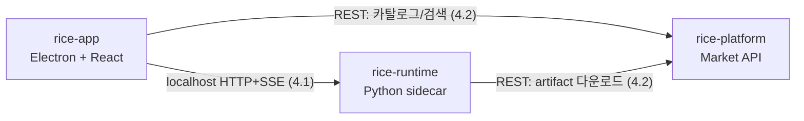

# RICE Repo Strategy (레포 구조 전략)

> 작성일: 2026-06-10 (개정: 2026-06-22)
> 목적: RICE의 초기 제품 구조와 레포 구조 전략 정리
> 선행 문서: 제품 컨셉은 [RICE_PRODUCT_IDEA.md](RICE_PRODUCT_IDEA.md), learning loop 참조 분석은 [HERMES_LEARNING_LOOP_REFERENCE.md](HERMES_LEARNING_LOOP_REFERENCE.md) 참고
> 모듈 구조 정본: [RICE_RUNTIME_DIRECTORY.md](RICE_RUNTIME_DIRECTORY.md) · 런타임/계약 설계: [RICE_RUNTIME_DESIGN.md](RICE_RUNTIME_DESIGN.md), [RICE_CONTRACTS.md](RICE_CONTRACTS.md)

---

## 1. 제품 개요

RICE는 macOS와 Windows를 모두 지원하는 로컬 데스크톱 애플리케이션이다.
핵심 제품 개념은 단순 채팅 앱이 아니라, **쓸수록 사용자에게 맞춰 학습·진화하는 에이전트**이다.

화면 구성(Chat / Skill Market / Plugin Market), Skill vs Plugin 구분, 데모 범위 등 제품 차원의 정의는 [RICE_PRODUCT_IDEA.md](RICE_PRODUCT_IDEA.md)를 단일 출처(source of truth)로 한다. 이 문서는 그 컨셉을 **어떤 레포 구조로 구현할 것인가**만 다룬다.

### 기술 스택

| 영역 | 위치 | 스택 |
|------|------|------|
| Frontend | `rice` repo / `rice-app/` | Electron, React, TailwindCSS, shadcn/ui |
| Agent Runtime | `rice` repo / `rice-runtime/` | Python |
| Market Platform | `rice-platform` repo (별도, Phase 2) | Python (API), React (admin-web) |

에이전트의 learning loop(경험에서 스킬 생성 → 사용하며 개선 → 세션을 넘나드는 user modeling)는 Hermes Agent 분석([HERMES_LEARNING_LOOP_REFERENCE.md](HERMES_LEARNING_LOOP_REFERENCE.md))을 참조 모델로 삼는다.

---

## 2. 핵심 아키텍처 관점

RICE는 단순 프론트엔드 앱이 아니라 아래 3개 축의 결합이다.

1. 데스크톱 앱 경험
2. 로컬 에이전트 런타임 및 learning loop
3. 공유/배포 플랫폼

중요한 판단:

- 앱 내부에 로컬 실행 엔진은 내장 가능
- 그러나 Skill Market / Plugin Market은 본질적으로 공유 플랫폼 성격이 강함
- 따라서 앱과 런타임만으로 끝내지 말고, 마켓 플랫폼 축을 별도 경계로 두는 것이 바람직함

현재 단계의 전제:
- show and prove 목적
- 권한/거버넌스/SSO는 당장 구현하지 않음
- 제품화 여부는 추후 판단

따라서 지금은 과도한 엔터프라이즈 설계보다 **확장 가능한 최소 구조**가 중요하다.

---

## 3. 레포 구성: ✅ 결정됨

### 현재 구조 (2026-06-22 결정)

```
rice/                    ← 단일 레포 (rice-app + rice-runtime)
├── rice-app/            ← Electron + React
├── rice-runtime/        ← Python 로컬 런타임
└── RICE_*.md            ← 설계 문서

rice-platform            ← 별도 레포 (Phase 2)
```

**rice-app + rice-runtime을 하나의 `rice` 레포에서 관리하는 이유:**
- 두 컴포넌트는 **하나의 설치형 데스크톱 앱으로 함께 배포**된다 — Electron이 PyInstaller 바이너리를 번들에 포함
- `rice-app`이 `rice-runtime`을 자식 프로세스로 spawn하는 구조상, 빌드 시 두 artifact가 함께 있어야 함
- `contracts/`(OpenAPI 스펙, SSE 스키마)도 `rice-runtime/contracts/`에 두고 `rice-app`에서 코드젠 — 한 레포 안에서 자연스럽게 해결
- 버전 스큐 없음, 교차 PR 불필요

**rice-platform을 별도 레포로 유지하는 이유:**
- 원격 클라우드 배포물로 rice-app/runtime과 배포 단위가 다름
- Phase 2 범위로, 현재 단계에서 함께 관리할 이유 없음

### 검토했던 대안

**대안: 3개 폴리레포 (`rice-app` / `rice-runtime` / `rice-platform`)**
- 초기 설계안. 런타임이 추후 CLI/게이트웨이 등 앱 외 접점을 가질 수 있고, TS/Python 팀 분업 경계라는 장점이 있었음.
- **번복 이유**: 설치형 앱은 배포 단위가 하나이므로, 폴리레포로 분리하면 빌드 시 다른 레포 artifact를 끌어오는 번거로움, 버전 스큐 관리 비용이 발생. 현재 단계(데모/프로토타입)에서 이 비용을 감수할 이유 없음.

---

## 4. 컴포넌트 간 인터페이스 (계약)

> rice-app과 rice-runtime은 같은 레포에 있지만, 런타임 프로세스 경계는 유지된다. 인터페이스 계약은 여전히 명시적으로 정의한다.

### 4.1 rice-app ↔ rice-runtime (로컬 IPC)

**확정 (상세 계약: [RICE_CONTRACTS.md](RICE_CONTRACTS.md) 1.2):**
- 런타임을 **localhost HTTP 서버(사이드카 프로세스)** 로 실행 (FastAPI)
- 스트리밍 응답은 **HTTP + SSE** — WebSocket 승격 없음. 승인 같은 요청-응답(위험 tool 실행·스킬 개선)도 SSE 제어 이벤트 + POST로 처리하며, 정지/재개(parking)·timeout·재연결은 [RICE_RUNTIME_DESIGN.md](RICE_RUNTIME_DESIGN.md) 5.1에서 명시 설계
- Electron main process가 런타임 프로세스의 spawn / health check / 재시작 / 종료를 책임짐
- 포트 충돌 회피와 인증(로컬 토큰) 최소 수준 포함

스트리밍은 **SSE 이벤트 9종**으로 learning loop을 가시화한다(이벤트 명세 정본은 [RICE_CONTRACTS.md](RICE_CONTRACTS.md) 1.3).

이 계약(API 스키마)이 두 레포의 공유 지점이므로, OpenAPI 스펙으로 정의하고 양쪽에서 타입을 생성하는 것을 기본 전략으로 한다 (4.3 참조).

### 4.2 rice-app / rice-runtime ↔ rice-platform (원격 REST)

- 마켓 카탈로그 조회, artifact 다운로드, 설치 manifest는 일반 REST API
- 설치 흐름: 앱이 platform에서 artifact를 받아 → 런타임의 로컬 디렉토리(skills/plugins)에 배치 → 런타임이 로드
- 데모 단계에서는 인증 없음 (제품화 시 SSO 확장 포인트)

### 4.3 공유 타입(shared-types) 전략

같은 `rice` 레포 안에서는 직접 import 가능하지만, 런타임 프로세스 경계를 명시적으로 유지하기 위해 코드젠 방식을 사용한다.

| 전략 | 내용 | 판단 |
|------|------|------|
| OpenAPI 스키마 + 코드젠 | `rice-runtime/contracts/`가 스펙 소유, `rice-app`이 TS 타입 생성 | **채택** — 계약이 명시적, 같은 레포라 코드젠 자동화 용이 |
| 수동 복제 | 양쪽에 같은 타입 정의 | 스큐 위험, 비권장 |

### 4.4 API 버전·호환 정책

3레포가 독립 배포되므로 **버전 스큐가 최대 리스크**다(3장 대안 B 경고). 정책:

- 각 OpenAPI 스펙에 `info.version`(semver) 부여. 앱은 기동 시 `GET /health`로 runtime API 버전을 확인한다.
- runtime ↔ app: **minor 추가는 하위호환, breaking change는 major + 앱 동시 배포**. 버전 불일치 시 앱이 경고한다.
- artifact `requires.runtime`(semver range)로 plugin ↔ runtime 호환을 검증한다.
- 코드젠은 CI에서 스펙 변경 시 자동 재생성 → 수동 드리프트 차단.

---

## 5. 각 레포의 책임 범위

### 5.1 `rice-app`

사용자 데스크톱 앱 전용 레포

포함 범위:
- Electron shell
- React UI (TailwindCSS, shadcn/ui)
- 채팅 / Skill Market / Plugin Market 화면
- 모델 설정 UI
- 로컬 세션 히스토리 UI
- 설치된 스킬/플러그인 관리 UI
- 로컬 캐시 및 앱 상태 관리
- **런타임 프로세스 라이프사이클 관리 (spawn/health/종료)**

책임: 사용자 경험, 데스크톱 앱 배포, OS 연동, 프론트엔드 제품 레이어

즉, `rice-app`은 **앱 셸 + 프론트엔드 제품 레이어**이다.

### 5.2 `rice-runtime`

로컬 에이전트 실행 및 orchestrate 역할을 담당하는 핵심 런타임 레포.
[HERMES_LEARNING_LOOP_REFERENCE.md](HERMES_LEARNING_LOOP_REFERENCE.md)에서 정리된 learning loop 구조를 실제 제품 핵심으로 가져가는 영역이다.

포함 범위:
- 대화 루프
- tool dispatch
- memory manager
- skill lifecycle (생성 · 상태전이 · **개선patch**)
- curator
- learning loop
- local storage abstraction
- plugin loading
- tool execution sandbox
- session/user modeling
- **connector management** (외부 서비스 연결 관리)
- **credential storage** (OS 키체인 연동)
- **permission system** (plugin/tool → connector 접근 검증)
- 로컬 API 서버 (4.1의 IPC 계약 구현) — SSE 9종 + 승인 parking(`approval.py`)
- **학습 측정 harness** (`eval/` — cold/warm 비교, `tests/`와 별개. [RICE_LEARNING_EVAL.md](RICE_LEARNING_EVAL.md))
- 추후 remote execution 확장 포인트

**내부 모듈 구조**: 6개 모듈(server / agent / execution / learning / connector / core)의 모듈화 모놀리스. 상세 디렉토리 트리·모듈 책임·핵심 불변식(직접 import 금지, composition_root 단일 와이어링)은 [RICE_RUNTIME_DIRECTORY.md](RICE_RUNTIME_DIRECTORY.md)(정본)를 참조한다.

Hermes 참조 문서 기준 대응 개념:
- `AIAgent.run_conversation()`
- `MemoryManager.prefetch_all()` / `sync_turn()`
- `Curator`, `skill_usage`
- `execute_code`, plugin registration 구조
- skill / plugin / connector lifecycle

책임: 앱의 두뇌, 학습/진화 메커니즘, 로컬 실행 엔진, 에이전트 오케스트레이션, 핵심 제품 IP

즉, `rice-runtime`은 **제품의 핵심 두뇌 레이어**이다.

### 5.3 `rice-platform`

Skill Market과 Plugin Market을 함께 다루는 공유 플랫폼 레포

포함 범위:
- 마켓 API
- 카탈로그 / 패키지 메타데이터 / 버전 관리
- 다운로드/배포
- 후원/포인트 데모 기능 (Blue Point)
- skill listing / plugin listing
- 설치 manifest
- 리뷰/추천 확장 포인트

중요한 설계 원칙:
- Skill Market과 Plugin Market의 백엔드는 하나로 둔다
- 대신 artifact type으로 구분한다: `artifact_type = skill | plugin`
- 이렇게 하면 초기에는 단순하게 운영하면서도, 나중에 승인 정책이나 운영 정책을 분리하기 쉽다

책임: 공유와 배포, 검색과 설치 메타데이터, 마켓 경험, 향후 조직 승인/거버넌스 확장 포인트

즉, `rice-platform`은 **배포 플랫폼 레이어**이다.

---

## 6. 구조 다이어그램



- `rice-app`이 사용자 접점이며 런타임 프로세스를 관리
- `rice-runtime`이 로컬 에이전트 실행
- `rice-platform`이 공유 마켓 제공

---

## 7. `rice` 레포 내부 구조

```
rice/
├── rice-app/            ← Electron + React
│   ├── electron/
│   ├── src/
│   ├── package.json
│   └── ...
├── rice-runtime/        ← Python 로컬 런타임
│   ├── contracts/       ← OpenAPI 스펙 소유 (rice-app이 코드젠)
│   │   ├── runtime.yaml
│   │   └── sse-events.schema.json
│   ├── src/rice_runtime/
│   └── pyproject.toml
└── RICE_*.md            ← 설계 문서
```

`rice-platform` (별도 레포, Phase 2):
- `apps/api` (OpenAPI 스펙 소유)
- `apps/admin-web`
- `packages/catalog`
- `packages/artifact-registry`
- `packages/billing-mock`

---

## 8. 추천 구현 순서

### Phase 0 — 계약 고정 (가장 먼저)
1. 4.1 app↔runtime IPC 방식 확정 + OpenAPI 스펙 초안
2. 9장의 미결정 사항 중 패키징 방식 확정 (데모 시연 환경에 직결)

### Phase 1 — 데모 핵심
1. `rice-runtime`
2. `rice-app`

목표:
- 채팅 화면, 모델 설정
- memory, skill 생성/개선
- plugin 설치/실행의 로컬 버전
- learning loop 데모

### Phase 2 — 마켓
3. `rice-platform`

목표:
- Skill 공유, Plugin 카탈로그
- 설치 가능한 마켓 경험
- 후원/포인트 데모

초기에는 단순 catalog와 mock 기능으로 시작하고, 이후 실제 플랫폼으로 확장한다.

---

## 9. 미결정 사항 (구현 전 결정 필요)

> 이 표는 **초기 스냅샷**이다. 확정 상태·근거의 단일 출처는 [DECISIONS.md](DECISIONS.md) + 각 설계 문서이며, #1·#2·#3·#5·#6은 이미 본문에 해소·반영됐다(RUNTIME_DESIGN·CONTRACTS). 남은 핵심은 #7(Connector OAuth = RD 9-A/CT 4-A) + 그 외 DECISIONS에 등록된 항목(LL-4·LL-5·LE-1~3 등).

| # | 항목 | 내용 | 영향 |
|---|------|------|------|
| 1 | **런타임 패키징** | 사용자 PC(macOS/Windows)에 Python 런타임을 어떻게 배포하는가 — PyInstaller 단일 바이너리 vs 임베디드 Python vs uv 기반 설치 | 데모 배포 가능 여부에 직결, Phase 0에서 결정 |
| 2 | IPC 방식 확정 | 4.1의 제안(localhost HTTP + SSE/WS) 확정 여부 | 두 레포의 개발 시작 조건 |
| 3 | 모델 프로바이더 | 어떤 LLM을 쓰는가 (SaaS=Claude / on-prem=Ollama), API 키 보관 위치 | Chat 화면의 "모델 선택" 범위 |
| 4 | **Plugin/Skill artifact 스펙** | 마켓에서 배포되는 artifact의 실체 — manifest 형식, 파일 구조, Connector(MCP) 연동 방식 | rice-platform과 runtime의 plugin loading 양쪽에 걸친 계약 |
| 5 | 설치 artifact 신뢰 | 마켓에서 받은 코드 실행에 대한 최소 안전장치 (데모 단계라도 sandbox 경계 정의) | runtime sandbox 설계 |
| 6 | Hermes 차용 범위 | Hermes 구조 중 무엇을 가져오고 무엇을 단순화하는가 (예: curator를 데모에 포함할지, memory provider는 1개로 고정할지) | runtime 스코프 |
| 7 | **Connector OAuth 흐름** | OAuth 2.0 Authorization Code Flow 구현 방안, 토큰 갱신 로직, Redirect URI 처리 (Electron 앱에서), 지원 대상 OAuth 프로바이더 | ConnectorsScreen 기능 구현, Plugin 권한 시스템 |

---

## 10. 최종 결론

✅ **`rice` 단일 레포** (rice-app + rice-runtime) + **`rice-platform` 별도 레포** (Phase 2)

실행 전략:
1. 컴포넌트 간 계약(IPC, artifact 스펙)과 패키징 방식을 먼저 고정한다 (Phase 0)
2. `rice-runtime`과 `rice-app`으로 learning loop 기반 데모를 만든다 (Phase 1)
3. Skill Market / Plugin Market은 `rice-platform` 별도 레포로 설계하고, 초기에는 단순 catalog와 mock으로 시작한다 (Phase 2)

---

## 11. 한 줄 요약

RICE는 단순 Electron 앱이 아니라,
**학습·진화하는 로컬 에이전트 런타임 + 데스크톱 앱 + 내부 공유 마켓 플랫폼**의 결합으로 설계해야 하며,
현재 단계에서 가장 현실적인 구조는 **`rice` 단일 레포(app + runtime) + `rice-platform` 별도 레포**이다.
